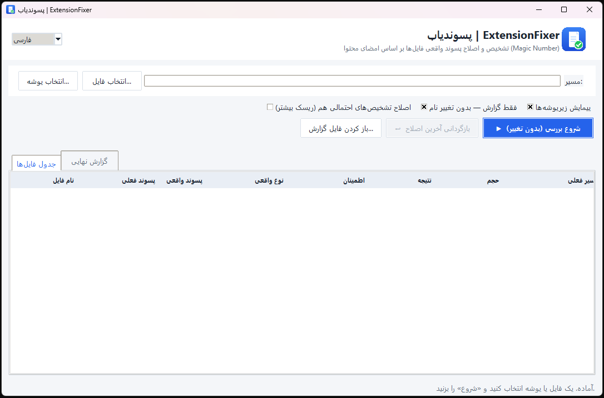

# پسوندیاب (ExtensionFixer) — پیدا و اصلاح پسوند واقعی فایل‌ها


**فارسی** | [English](README.md)

> **یادداشت:** این برنامه و README آن (فارسی و انگلیسی) با کمک هوش مصنوعی توسعه داده شده‌اند.

فایلی به نام `holiday.mp4` که پخش نمی‌شود یا `photo.jpg`‌ای که هیچ برنامه‌ای بازش نمی‌کند، معمولاً یک مشکل مشترک دارند: **پسوند دروغ می‌گوید**. حروف بعد از نقطه فقط یک برچسب‌اند — نوع *واقعی* فایل داخل خود فایل و به‌صورت **امضا (Magic Number)** نوشته شده است.

**پسوندیاب** این امضا را می‌خواند، آن را با پسوند فعلی مقایسه می‌کند، دقیق نشان می‌دهد کدام فایل‌ها برچسب اشتباه دارند — و اگر شما اجازه بدهید، پسوندشان را اصلاح می‌کند. یک ابزار کوچک، امن و آفلاین با رابط تمیز دوزبانه (فارسی / انگلیسی).

## فهرست

1. [اسکرین‌شات‌ها](#اسکرینشاتها)
2. [چطور کار می‌کند](#چطور-کار-میکند)
3. [امنیت](#امنیت)
4. [امکانات](#امکانات)
5. [اجرای سورس](#اجرای-سورس)
6. [ساخت فایل EXE](#ساخت-فایل-exe)
7. [تست‌ها](#تستها)
8. [ساختار فایل‌ها](#ساختار-فایلها)
9. [لایسنس](#لایسنس)

## اسکرین‌شات‌ها

*برای دیدن سایز کامل روی تصویر کلیک کنید.*



## چطور کار می‌کند

1. **مسیر را انتخاب کنید** — یک فایل، یا یک پوشه‌ی کامل (با یا بدون زیرپوشه‌ها).
2. **اسکن** — برنامه چند بایت اول هر فایل را می‌خواند و با بیش از ۶۰ امضای شناخته‌شده مقایسه می‌کند (JPEG، PNG، PDF، MP4، ZIP، EXE، SQLite و…). کار از یک جدول ساده هم فراتر می‌رود:
   - کانتینرهای ZIP باز می‌شوند تا **DOCX / XLSX / PPTX / APK / JAR / EPUB** از هم تفکیک شوند — حتی نسخه‌های ماکرو-دار و قالب‌ها (**XLSM / DOCM / DOTX / PPSX** از `[Content_Types].xml` خوانده می‌شوند)؛
   - **ساختار دایرکتوری OLE2 واقعاً پارس می‌شود** (زنجیره‌ی FAT + دایرکتوری) تا نسخه‌های قدیمی **.doc / .xls / .ppt / .msg / .vsd** با نام واقعی استریم‌های داخلی از هم تشخیص داده شوند — بدون حدس زیررشته‌ای؛
   - برند `ftyp` داخل MP4، خانواده‌ی **MP4 / MOV / M4A / HEIC / AVIF** را جدا می‌کند و هدر OGG، **Opus / Vorbis / Theora** را از هم تشخیص می‌دهد؛
   - **خانواده‌ی پسوندها** محترم شمرده می‌شود: فایلی که امضای PE ویندوز دارد می‌تواند `.dll`/`.sys` بماند، فایل TIFF-هدر می‌تواند `.cr2`/`.nef`/`.dng` بماند، Matroska می‌تواند `.webm` بماند و ZIP می‌تواند `.whl`/`.vsix`/`.nupkg`/`.cbz` بماند — هیچ‌کدام «پسوند غلط» حساب نمی‌شوند.
3. **اول گزارش (پیش‌فرض)** — اجرا فقط *گزارش* می‌سازد: جدول، وضعیت هر فایل، پسوند فعلی و نوع واقعی را نشان می‌دهد و گزارش کامل در یک فایل `.txt` ذخیره می‌شود. هیچ فایلی تغییر نمی‌کند.
4. **اجرای واقعی** — تیک «فقط گزارش — بدون تغییر نام» را بردارید و دوباره «شروع» را بزنید. یک **پنجره‌ی تأیید** تعداد فایل‌ها و پیش‌نمایش (نام قبلی → نام جدید) را نشان می‌دهد و تا تأیید شما هیچ چیز عوض نمی‌شود. فقط فایل‌هایی اصلاح می‌شوند که تشخیص‌شان *قطعی* است (تطابق واقعی با امضا + پسوند شناخته‌شده)؛ حدس‌های احتمالی/متنی و پسوندهای ناشناخته دست‌نخورده می‌مانند مگر گزینه‌ی «موارد پرریسک» را خودتان فعال کنید.
5. **بازگردانی (Undo)** — هر اجرای واقعی یک لاگ بازگردانی می‌سازد؛ با یک کلیک همه‌ی نام‌های قبلی برمی‌گردند. اگر برنامه را بسته‌اید هم می‌توانید هر کدام از لاگ‌های قبلی را باز کنید و برگردانید.

## امنیت

- **هیچ‌وقت چیزی را رونویسی نمی‌کند** — اگر نام مقصد از قبل وجود داشته باشد، پسوند یکتای ` (1)` اضافه می‌شود.
- **تأیید قبل از هر اجرای واقعی** — قبل از هر تغییری، تعداد فایل‌ها و پیش‌نمایش «قبلی → جدید» را می‌بینید.
- **احترام به خانواده‌ی پسوندها** — `exe` شامل `dll/sys/ocx/scr` است، `tif` شامل `cr2/nef/arw/dng`، `mkv` شامل `webm`، `ogg` شامل `opus`، `gz` شامل `tgz`، `sqlite` شامل `db`، `zip` شامل `whl/vsix/nupkg/cbz/…`، `pdf` شامل `ai`، `json` شامل `ipynb/geojson`، `html` شامل `php/vue` و `xml` شامل `csproj/xaml` — فایل درست هرگز «اصلاح» نمی‌شود.
- **فقط پسوندهای شناخته‌شده اصلاح می‌شوند** — اگر پسوند فعلی فایل اصلاً یک فرمت شناخته‌شده نباشد (مثل `.xyz`)، فقط گزارش می‌شود و تغییر نام نمی‌دهد (مگر گزینه‌ی «موارد پرریسک» را آگاهانه فعال کنید که پسوندهای ناشناخته را هم اصلاح می‌کند).
- **فرمت‌های مبهم دست‌نخورده می‌مانند** — فایل OLE2ای که استریم آفیس قابل‌شناسایی ندارد (مثل `.msi`) هرگز به‌کور به `.doc` تغییر نام نمی‌دهد.
- **فایل ماکرو، ماکرو می‌ماند** — XLSM/DOCM/PPTM/PPSX و قالب‌ها از XLSX/DOCX/PPTX ساده تفکیک می‌شوند؛ ماکرو یا نوع قالب هرگز از بین نمی‌رود.
- **فایل‌های بدون پسوند** در اجرای واقعی پسوند درست می‌گیرند؛ فایل‌های مخفی مثل `.gitignore` هرگز دست نمی‌خورند.
- **مقایسه با آگاهی از نام‌های مستعار** — `jpg == jpeg == jfif`، `tif == tiff` و…؛ فایل درست، به اشتباه «اشتباه» اعلام نمی‌شود.
- **لاگ بازگردانی مقاوم به کرش** — پیش از هر تغییر نام، هویت فایل (اندازه + زمان تغییر) با `fsync` ثبت می‌شود و مسیر نهایی واقعی بلافاصله بعد از آن افزوده می‌شود؛ لاگ هرگز بازنویسی نمی‌شود، پس کرش وسط کار فقط لاگِ ناقص می‌سازد و بازگردانی ممکن است. Undo پیش از برگرداندن، هویت هر فایل را می‌سنجد و هرگز فایلی را که بعد از اصلاح تغییر کرده یا از نو ساخته شده دست نمی‌زند. لاگ‌های قبلی هم قابل بازگشایی و برگرداندن‌اند.
- **پوشه‌های سیستمی رد می‌شوند** — زیرپوشه‌هایی با نام `Windows`، `Program Files`، `$RECYCLE.BIN`، `node_modules`، `.git`، `venv`، `env`، `AppData` و… و همچنین symlinkها هرگز پیمایش نمی‌شوند. (چون تطبیق بر اساس «نام پوشه» است، یک پوشه‌ی معمولی که اتفاقاً `env` یا `windows` نام دارد هم رد می‌شود.)
- **مسیرهای سیستمی برای اجرای واقعی مسدودند** — ریشه‌ی درایو (`C:\`) و پوشه‌های سیستمی (`C:\Windows`، `Program Files` و…) را نمی‌توان تغییر نام داد؛ فقط حالت «فقط گزارش» کار می‌کند.
- **امضاهای ضعیف اعتبارسنجی می‌شوند** — امضاهای کوتاه (`ID3`، `BZh`، `OTTO`، `MSCF`، هدر فریم MP3/AAC، هدر ICO/TTF و…) ساختاری بررسی می‌شوند؛ پس یک فایل متنی که فقط با همین حروف شروع می‌شود هرگز صوت/آرشیو/فونت حساب نمی‌شود؛ امضای tar علاوه بر آن با چک‌سام هدر هم اعتبارسنجی می‌شود. امضاهای تمام-ASCII (`GIF89a`، `RIFF…WAVE`، `ustar`، `!<arch>`، `BZh91AY&SY`) روی فایل متنی ساده نادیده گرفته می‌شوند و torrent هم هرگز «قطعی» نیست (bencode ذاتاً متنی است).
- **زیرنوع ZIP محافظه‌کارانه است** — فقط ساختارهای بدون ابهام (Office/OpenDocument/OpenOffice قدیمی SXW-SXD/EPUB/APK/VSIX/WHL/XPI/KMZ) از `.zip` تغییر نام می‌گیرند؛ یک zip معمولیِ شبیه پروژه‌ی Java/Android همان `.zip` می‌ماند.

## امکانات

- تشخیص **بیش از ۶۰ فرمت** از روی محتوا، شامل زیرنوع‌های سخت (ماکرو/قالب‌های OOXML، استریم‌های OLE2، برندهای MP4، کدک‌های OGG)
- **دوزبانه (فارسی / انگلیسی)** — زبان از زبان سیستم تشخیص داده می‌شود، از کمبوی سربرگ به‌صورت زنده عوض می‌شود و انتخاب شما در `~/.extension_fixer.json` به‌خاطر سپرده می‌شود
- **حالت گزارش (پیش‌فرض)** و **حالت اصلاح واقعی با تأییدیه و پیش‌نمایش** — همیشه قبل از هر تغییر، نتیجه را می‌بینید
- مقایسه‌ی نرمال‌شده با نام‌های مستعار و **خانواده‌ی پسوندها** (بدون نتیجه‌ی اشتباهِ «پسوند غلط»)
- **بازگردانی یک‌کلیکی** آخرین عملیات اصلاح + بازگشایی لاگ‌های اجراهای قبلی
- گزارش متنی کامل در `~/.extension_fixer_logs/report_*.txt`
- اسکن بازگشتی با رد کردن پوشه‌های سیستمی و جدول محدودشده برای پوشه‌های خیلی بزرگ
- رابط مدرنِ روشن؛ چیدمان راست‌به‌چپ برای فارسی و چپ‌به‌راست برای انگلیسی
- فقط کتابخانه‌ی استاندارد پایتون — **بدون هیچ وابستگی‌ای**، چیزی برای نصب نیست

## اجرای سورس

پایتون 3.8 به بالا لازم است (Tkinter همراهش هست). در ویندوز کافی است روی **`run.bat`** دابل‌کلیک کنید، یا:

```
python filetype_gui.py
```

## ساخت فایل EXE

PyInstaller نمی‌تواند کراس-کامپایل کند، پس باید **روی ویندوز** بسازید. فقط یک بار اجرا کنید:

```
build_exe.bat
```

خروجی در `dist\ExtensionFixer.exe` قرار می‌گیرد — یک فایل قابل‌حملِ تک‌فایله، بدون پنجره‌ی کنسول و با آیکون برنامه.

> **چرا اجرای EXE تک‌فایله کمی کندتر شروع می‌شود؟** در هر بار اجرا، فایل خودش را در یک پوشه‌ی موقت باز می‌کند (حدود ۱ تا ۳ ثانیه روی SSD). بعد از آن، سرعت اجرا دقیقاً با نسخه‌ی `.py` یکسان است.

## تست‌ها

موتور تشخیص **۴۲ تست واحد** دارد (فقط کتابخانه‌ی استاندارد):

```
python -m unittest discover -s tests -v
```

همین تست‌ها در هر push به‌صورت خودکار در GitHub Actions اجرا می‌شوند — روی ویندوز و لینوکس، با پایتون 3.8 و 3.12.

## ساختار فایل‌ها

```
filetype_core.py    موتور تشخیص و اصلاح (امضاها، لاگ بازگردانی)
filetype_gui.py     رابط گرافیکی (Tkinter) — دوزبانه فارسی/انگلیسی
tests/              تست‌های واحد موتور تشخیص و تغییر نام
run.bat             اجرای سورس (ویندوز)
build_exe.bat       ساخت EXE تک‌فایله (ویندوز)
assets/             icon.ico + icon.png
docs/               اسکرین‌شات‌ها
```

## لایسنس

منتشرشده تحت [لایسنس MIT](LICENSE) — Copyright (c) 2026 [mohamma-aa](https://github.com/mohamma-aa).
