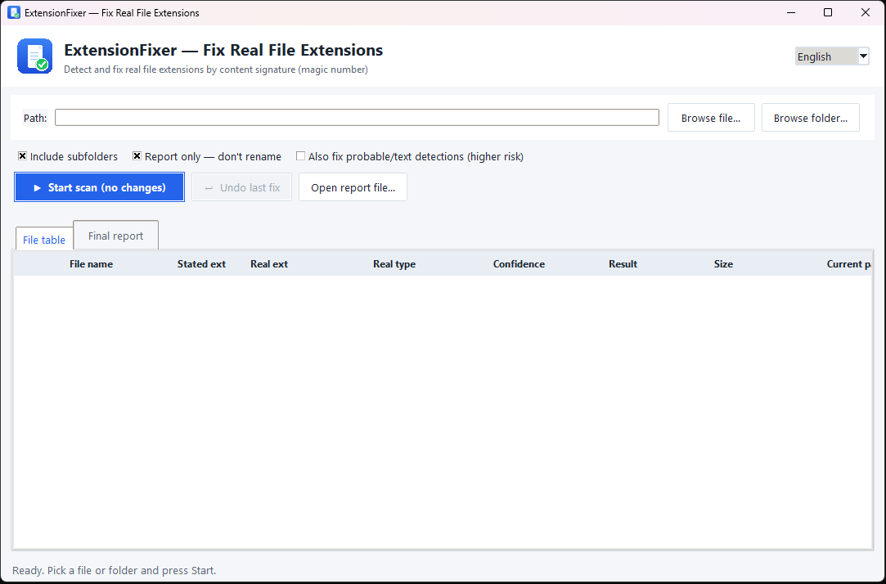

# ExtensionFixer — Find & Fix Real File Extensions


**English** | [فارسی](README.fa.md)

> **Note:** this program and its README (English and Persian) were developed with the help of AI.

A file named `holiday.mp4` that refuses to play, or a `photo.jpg` that no program opens, usually has one thing in common: **the extension lies**. The letters after the dot are just a label — the *real* type is written inside the file itself as a **magic number / file signature**.

**ExtensionFixer** reads that signature, compares it with the stated extension, shows you exactly which files are mislabeled — and, if you let it, fixes the extensions. It is a small, safe, offline tool with a clean bilingual (English / Persian) interface.

## Contents

1. [Screenshots](#screenshots)
2. [How it works](#how-it-works)
3. [Safety](#safety)
4. [Features](#features)
5. [Run from source](#run-from-source)
6. [Building the executable (exe)](#building-the-executable-exe)
7. [Tests](#tests)
8. [File layout](#file-layout)
9. [License](#license)

## Screenshots

*Click the image to view it full size.*



## How it works

1. **Pick a path** — one file, or a whole folder (with or without subfolders).
2. **Scan** — the app reads the first bytes of every file and matches them against 60+ known signatures (JPEG, PNG, PDF, MP4, ZIP, EXE, SQLite, …). It goes deeper than a plain table lookup:
   - ZIP containers are opened to tell **DOCX / XLSX / PPTX / APK / JAR / EPUB** apart — including macro-enabled and template subtypes (**XLSM / DOCM / DOTX / PPSX** are read from `[Content_Types].xml`);
   - the **OLE2 directory structure is actually parsed** (FAT chain + directory entries), so legacy **.doc / .xls / .ppt / .msg / .vsd** are told apart by their real internal stream names — no substring guessing;
   - the MP4 `ftyp` brand separates **MP4 / MOV / M4A / HEIC / AVIF**, and the OGG header separates **Opus / Vorbis / Theora**;
   - **extension families** are respected: a file whose signature is generic Windows-PE stays `.dll`/`.sys`, a TIFF-header file stays `.cr2`/`.nef`/`.dng`, a Matroska file stays `.webm`, a ZIP stays `.whl`/`.vsix`/`.nupkg`/`.cbz` — none of these are treated as “wrong extensions”.
3. **Report first (default)** — the run only *reports*: the table shows every file with its stated extension, real type and result, and a full report is saved as a `.txt` file. Nothing is renamed.
4. **Real run** — untick **“Report only — don't rename”** and press Start again. A **confirmation dialog** shows how many files will be renamed and a preview (`old → new`); nothing changes until you confirm. Only files whose detection is *certain* (real magic-number match with a known extension) get fixed; probable/text guesses and unknown extensions are left alone unless you explicitly enable the “risky items” option.
5. **Undo** — every real run writes an undo log; one click restores all previous names. If the program was closed meanwhile, you can reopen any previous undo log file and restore it.

## Safety

- **Never overwrites anything** — if the target name already exists, a unique ` (1)` suffix is added.
- **Confirmation before every real run** — you see the count and a `old → new` preview before anything is renamed.
- **Extension families are respected** — `exe` covers `dll/sys/ocx/scr`, `tif` covers `cr2/nef/arw/dng`, `mkv` covers `webm`, `ogg` covers `opus`, `gz` covers `tgz`, `sqlite` covers `db`, `zip` covers `whl/vsix/nupkg/cbz/…`, `pdf` covers `ai`, `json` covers `ipynb/geojson`, `html` covers `php/vue`, `xml` covers `csproj/xaml` — correct files are never “fixed”.
- **Only known extensions are touched** — if a file's current extension is not a known format at all (e.g. `.xyz`), it is only reported, never renamed (unless you explicitly enable the “risky items” option, which also fixes unknown extensions).
- **Unknown / ambiguous formats are untouched** — an OLE2 file with no recognizable Office streams (e.g. `.msi`) is never blindly renamed to `.doc`.
- **Macro files stay macro files** — XLSM/DOCM/PPTM/PPSX templates and macro workbooks are told apart from plain XLSX/DOCX/PPTX, so enabling-macros or template type is never destroyed.
- **Extensionless files** get their true extension appended (optionally, only in a real run); hidden files like `.gitignore` are never touched.
- **Alias-aware** — `jpg == jpeg == jfif`, `tif == tiff`, … so correct files are never "fixed" by mistake.
- **Crash-safe undo log** — before each rename, the file's identity (size + modification time) is logged with `fsync`, and the real final name is appended right after; the log is never rewritten, so a crash mid-run always leaves a valid log that can be undone. Undo also verifies each file's identity before restoring, so it never touches a file that was modified or recreated after the fix. Previous logs can be reopened and restored.
- **System folders are skipped** — subfolders named `Windows`, `Program Files`, `$RECYCLE.BIN`, `node_modules`, `.git`, `venv`, `env`, `AppData`, … and symlinks are never touched. (Because this is matched by folder *name*, a normal folder that happens to be called `env` or `windows` is skipped too.)
- **System locations are blocked for real runs** — a drive root (`C:\`) or a system folder (`C:\Windows`, `Program Files`, …) cannot be renamed in; only “Report only” works there.
- **Weak signatures are validated** — short magic numbers (`ID3`, `BZh`, `OTTO`, `MSCF`, MP3/AAC frame sync, ICO/TTF headers, …) are checked structurally, so a text file that merely *starts* with those letters is never treated as audio/archive/font; the tar signature is additionally verified by its header checksum. All-ASCII magics (`GIF89a`, `RIFF…WAVE`, `ustar`, `!<arch>`, `BZh91AY&SY`) are ignored for plain-text files, and BitTorrent is never "certain" (its bencode form is text-like).
- **ZIP subtypes are conservative** — only unambiguous layouts (Office/OpenDocument/legacy OpenOffice SXW-SXD/EPUB/APK/VSIX/WHL/XPI/KMZ) are renamed from `.zip`; a normal zip that looks like a Java/Android project stays `.zip`.

## Features

- Detects **60+ formats** by content, including tricky sub-types (OOXML macros/templates, OLE2 streams, MP4 brands, OGG codecs)
- **Bilingual (Persian / English)** — auto-detected from the OS language, switchable live from the header combo box; your choice is remembered in `~/.extension_fixer.json`
- **Report mode (default)** and **real fix mode with confirmation + preview** — you always see before anything changes
- Family-aware, alias-normalized comparison (no false "wrong extension" results)
- One-click **Undo** of the last fix operation, plus reopening of previous undo logs
- Full text report saved to `~/.extension_fixer_logs/report_*.txt`
- Recursive scan with junk/system folder skipping and a row-capped table for huge folders
- Modern light UI, RTL layout for Persian, LTR for English
- Pure Python standard library — **no dependencies**, nothing to install

## Run from source

Requires Python 3.8+ (Tkinter included). On Windows just double-click **`run.bat`**, or:

```
python filetype_gui.py
```

## Building the executable (exe)

PyInstaller cannot cross-compile, so build **on Windows**. Just run once:

```
build_exe.bat
```

The output lands in `dist\ExtensionFixer.exe` — a single portable file, no console window, with the app icon.

> **Why does a onefile exe start a bit slower?** At every launch it unpacks itself into a temporary folder (about 1–3 s on an SSD). After that, runtime speed is exactly the same as running the `.py` version.

## Tests

The detection engine has a unit-test suite — **42 tests**, pure standard library:

```
python -m unittest discover -s tests -v
```

The same tests run automatically on every push in GitHub Actions — on Windows and Linux, Python 3.8 and 3.12.

## File layout

```
filetype_core.py    detection + rename engine (magic numbers, undo log)
filetype_gui.py     GUI (Tkinter) — bilingual fa/en
tests/              unit tests for the detection / rename engine
run.bat             run from source (Windows)
build_exe.bat       build the onefile exe (Windows)
assets/             icon.ico + icon.png
docs/               screenshots
```

## License

Released under the [MIT License](LICENSE) — Copyright (c) 2026 [mohamma-aa](https://github.com/mohamma-aa).
